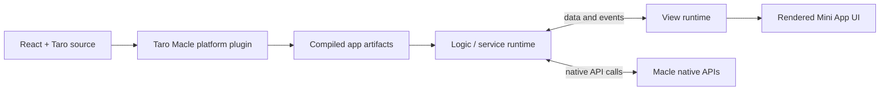

# Macle runtime: a working mental model

Taro lets developers describe pages with React components and APIs. Its Macle platform plugin compiles that project into artifacts understood by the Macle runtime. The exact generated files and runtime internals depend on the plugin/compiler version.

## Lesson prompts

1. Inspect the generated output after a build.
2. Find the page lifecycle logs and compare them to the visible page.
3. Change one piece of React state and observe the resulting UI update.
4. Compare a successful build with the same project in the simulator.

Treat names such as `service.js`, `view.js`, MAML, and generated update calls as implementation details to verify for the installed compiler/runtime version.
