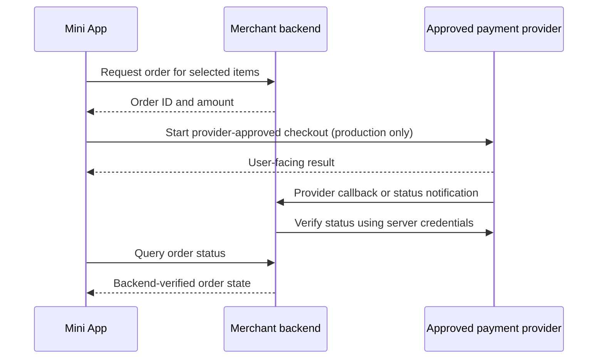

# Payment flow: trusted boundaries

This diagram describes the **demo architecture**. The capstone uses a simulated checkout and does not initiate a real Telebirr transaction.

Do not trust a client success callback as proof of payment. Keep signing keys on the backend, verify provider notifications/status server-side, make order updates idempotent, and never request or store a payment PIN in app code.
